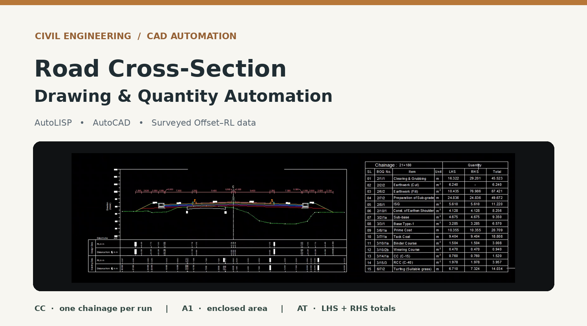
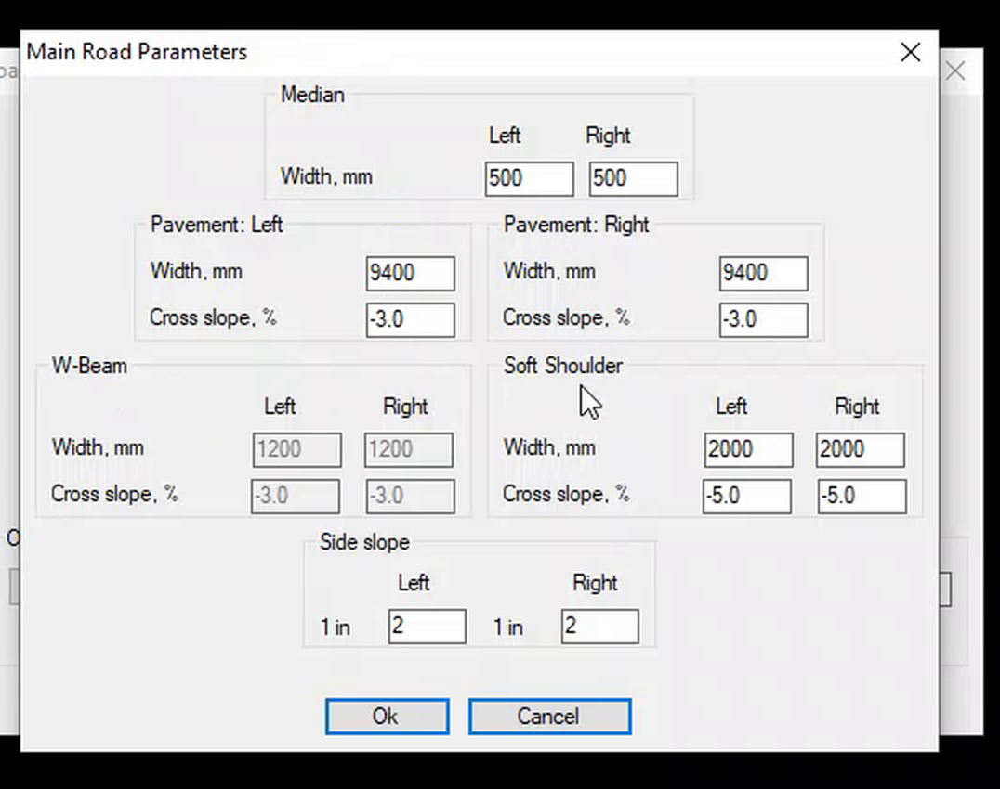
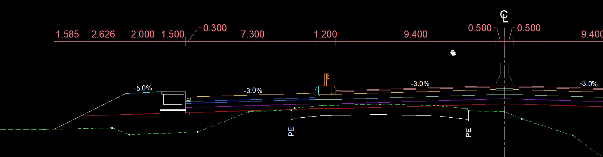
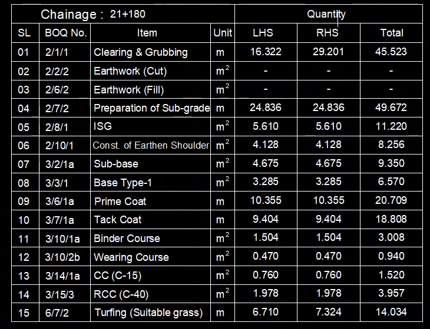
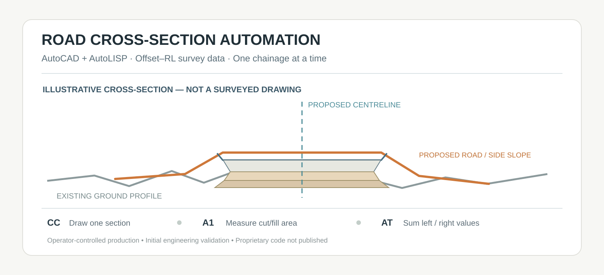

# AutoLISP Road Cross-Section Drawing & Earthwork Quantity Automation

**Engineer-supervised AutoCAD automation for road construction drawings and earthwork quantity calculations.**

This portfolio project documents an AutoLISP-based tool developed for road construction work involving cross-sections at approximately **20-metre chainage intervals** in urban areas. It uses surveyed **offset and Reduced Level (RL)** observations and configurable road-design parameters. The main routine deliberately draws **one chainage per execution** so an engineer can review each section and its associated calculations.

> **Portfolio documentation only.** The original AutoLISP source code, program files, client DWGs and unedited screen recording are not distributed here. This repository is not a runnable software release.

## Project overview

| Attribute | Details |
|---|---|
| Domain | Road construction; civil engineering CAD |
| Technology | AutoCAD and AutoLISP |
| Typical section spacing | 20 m in the cited urban-road workflow |
| Data input | Survey offsets and elevations (RL), pavement-edge markers, right-side separator, design RL and chainage |
| Key operations | Cross-section drafting, area calculation and left/right quantity summation |
| Approach | One-chainage processing with engineer review |
| Source availability | Proprietary; not published |

## Three AutoLISP commands

| Command | Function |
|---|---|
| `CC` | **Main command**: generates the road cross-section drawing for one chainage using survey observations and design parameters. |
| `A1` | Finds the area of an enclosed boundary, used for cut or fill calculations. |
| `AT` | Sums corresponding quantities from the left-hand and right-hand sides. |

The commands are part of the author's own AutoCAD program and **cannot be run by downloading this documentation repository**.

## Demonstrated technical capabilities

- Work with field-survey offset–RL measurements.
- Configure drawing parameters for the road section, including cross slopes, pavement widths, side slopes and other road components.
- Draw and annotate existing terrain and proposed road cross-section geometry.
- Represent roadway components and provide drawing-level dimensional and elevation information.
- Measure enclosed areas and combine quantity values, with operator review.
- Adjust section-specific parameters when terrain or road geometry changes.

## Why the program handles one chainage at a time

**This is an intentional quality-control design, not a programming limitation.** Processing an entire road without intermediate review can propagate unnoticed mistakes. In real projects:

1. Survey offsets or elevations may contain transcription, measurement or formatting errors.
2. Numerical input follows fixed formatting conventions.
3. The farthest surveyed points on each side must extend sufficiently for the designed side-slope lines and ground intersections.
4. Road geometry may change between sections, especially cross slopes at curves requiring superelevation adjustments.
5. Drawing geometry and calculated quantities must be reviewed before moving to the next section.

Accordingly, the workflow is **engineer-supervised drafting and quantity automation**. It does not imply that every possible input error is automatically detected or that the output quantities have been independently certified.

## Input-data format

The supplied project example is a text file using **offset** in the first column and **RL** in the second. The format also uses:

- `PE`: existing pavement-edge marker
- `R/S`: start of observations on the right-hand side
- `END`: end of observed point records
- Line immediately after `END`: proposed-road **design RL**
- Final line: **chainage identifier**

For a **synthetic documentation example**, see [sample-data/synthetic_offset_RL_01+000.txt](sample-data/synthetic_offset_RL_01%2B000.txt). The sample is illustrative and has not been tested with the proprietary routine.

## Documentation

- [Offset–RL format explained](docs/INPUT-DATA-FORMAT.md)
- [Engineer-supervised quality-control workflow](docs/QUALITY-CONTROL-WORKFLOW.md)
- [Demonstration-video and disclosure checklist](docs/VIDEO-DEMO-NOTES.md)

## Road cross-section demonstrations

The following selected images document the engineering interface and generated output of the AutoLISP workflow. They are **portfolio illustrations, not independently verified as-built measurements**.

### Main-road design configuration

Road design inputs are inspected for the chainage being processed, including roadway geometry and section-specific parameters.

### Road cross-section details

The drawing represents existing field ground and proposed road geometry, with elevations and annotations.

### Generated section and earthwork quantities

The generated drawing provides a basis for inspecting section geometry and associated quantity calculations.

### Quantity calculation table

The engineer may use `A1` to measure enclosed areas and `AT` to combine corresponding left- and right-side quantity values.

### Illustrative survey data format

The field-data format captures offsets and RL values, with section markers and design information. The graphic is an explanation of input structure, not a substitute for the original survey records.

### Conceptual workflow diagram

*Conceptual diagram only; not a surveyed or generated CAD drawing.*

**Video:** A redacted recording can be added after publication permissions and visual disclosure checks are complete. The original unedited recording and proprietary AutoLISP source code are not included. See the [video preparation checklist](docs/VIDEO-DEMO-NOTES.md).

## Engineering and technical focus

`AutoLISP` · `AutoCAD` · `Road Cross-Sections` · `Survey Offset–RL` · `Earthwork Quantities` · `Cut and Fill` · `CAD Automation` · `Engineer-Supervised QA`

## Authorship

Developed and documented by **Lutfor Rahman** as part of professional CAD and engineering-automation work. The repository demonstrates the engineering workflow and the author's relevant experience rather than distributing a licensed implementation.

For suitable custom AutoCAD automation or civil-engineering drafting work, contact the author through his professional profile.
