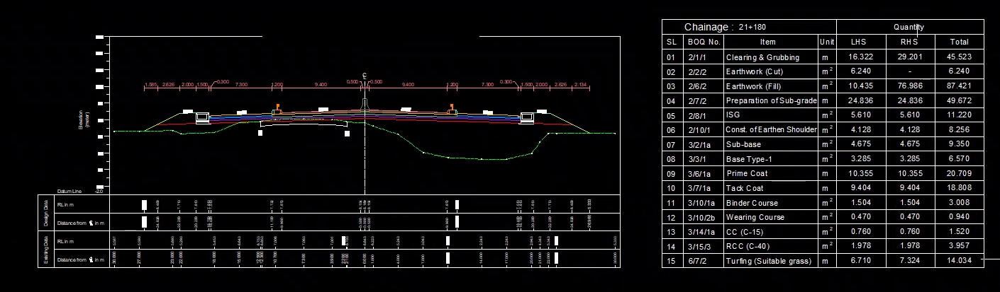
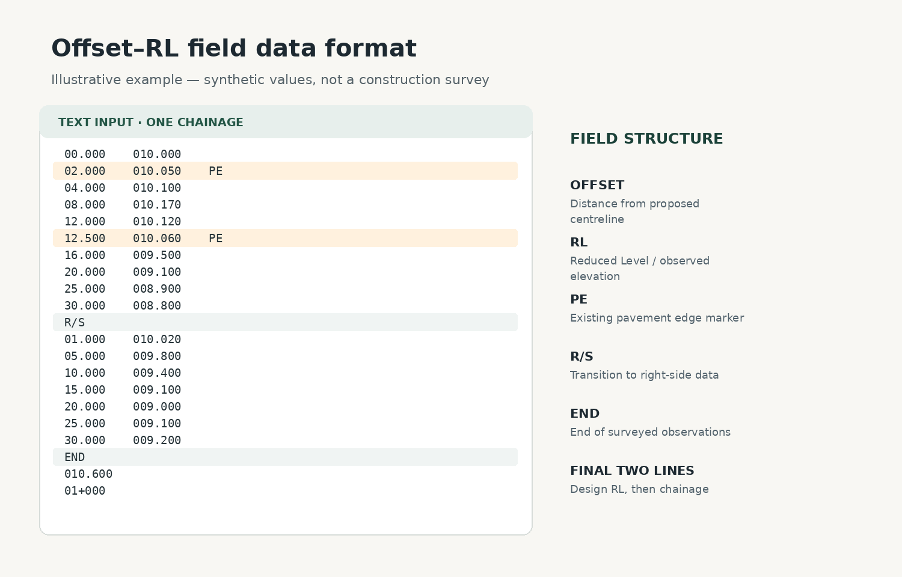

# AutoLISP Road Cross-Section Drawing & Earthwork Quantity Automation

**AutoCAD/AutoLISP automation for road cross-section drawings and earthwork quantity calculations, with operator-controlled chainage processing.**

This portfolio project documents an AutoLISP-based tool developed for road construction work involving cross-sections at approximately **20-metre chainage intervals** in urban areas. It uses surveyed **offset and Reduced Level (RL)** observations and configurable road-design parameters. The main routine deliberately draws **one chainage per execution**, allowing the CAD Operator/CAD Engineer to enter suitable design parameters, process individual sections and continue producing drawings. The Project Engineer checks a selection of initial drawings and calculations to establish confidence in the program; once satisfied, the CAD Engineer proceeds without requiring approval of every subsequent section.

> **Portfolio documentation only.** The original AutoLISP source code, program files, client DWGs and unedited screen recording are not distributed here. This repository is not a runnable software release.

## Project overview

| Attribute | Details |
|---|---|
| Domain | Road construction; civil engineering CAD |
| Technology | AutoCAD and AutoLISP |
| Typical section spacing | 20 m in the cited urban-road workflow |
| Data input | Survey offsets and elevations (RL), pavement-edge markers, right-side separator, design RL and chainage |
| Key operations | Cross-section drafting, area calculation and left/right quantity summation |
| Approach | Operator-controlled, one-chainage processing; initial Project Engineer validation |
| Source availability | Proprietary; not published |

## Three AutoLISP commands

| Command | Function |
|---|---|
| `CC` | **Main command**: generates the road cross-section drawing for one chainage using survey observations and design parameters. |
| `A1` | Finds the area of an enclosed boundary, used for cut or fill calculations. |
| `AT` | Sums corresponding quantities from the left-hand and right-hand sides. |

The commands are part of the author's own AutoCAD program and **cannot be run by downloading this documentation repository**.

## Demonstrated technical capabilities

- Work with field-survey offset–RL measurements.
- Configure drawing parameters for the road section, including cross slopes, pavement widths, side slopes and other road components.
- Draw and annotate existing terrain and proposed road cross-section geometry.
- Represent roadway components and provide drawing-level dimensional and elevation information.
- Measure enclosed areas and combine quantity values, with operator review.
- Adjust section-specific parameters when terrain or road geometry changes.

## Actual production workflow

1. **Field Surveyors** collect survey offsets and Reduced Levels (RL) and submit field records to the office.
2. **Data Entry Operators** enter the survey observations and format the text files to meet the routine's input requirements.
3. **AutoCAD Operator / CAD Engineer** selects the chainage, enters appropriate design parameters in the program dialogs, and executes `CC` to produce the cross-section drawing and its associated calculations. The `A1` and `AT` commands support area measurement and left/right value summation.
4. **Project Engineer** verifies a selection of initial cross-section drawings and calculations. When satisfied with their correctness and the program's performance, the Project Engineer authorizes continued production.
5. **CAD Engineer** prepares the remaining cross-sections by running the program chainage by chainage. **Routine Project Engineer approval of each subsequent drawing is not required** after confidence in the program has been established.

## Why one chainage per execution?

The one-chainage design is **intentional operator-controlled automation**, not an inability to process the full road. It allows the CAD Operator to work with section-specific survey and design inputs, particularly where cross slopes or superelevation vary on curves, and helps avoid carrying an incorrect parameter setting across multiple sections.

In the established workflow, the author identifies **two principal operational error sources**:

- **Data entry / formatting:** errors when field survey observations are entered or prepared in the text format required by the program. The survey offsets must also cover the designed side-slope extents.
- **Design-parameter entry:** incorrect values entered into the program's dialog boxes, including section-specific parameters such as cross slopes.

The purpose of the per-chainage execution is to maintain appropriate control over changing inputs and parameters. It **does not mean the Project Engineer personally inspects every produced drawing**, and the repository does not claim that the program independently detects all input errors.

## Input-data format

The supplied project example is a text file using **offset** in the first column and **RL** in the second. The format also uses:

- `PE`: existing pavement-edge marker
- `R/S`: start of observations on the right-hand side
- `END`: end of observed point records
- Line immediately after `END`: proposed-road **design RL**
- Final line: **chainage identifier**

For a **synthetic documentation example**, see [sample-data/synthetic_offset_RL_01+000.txt](sample-data/synthetic_offset_RL_01%2B000.txt). The sample is illustrative and has not been tested with the proprietary routine.

## Documentation

- [Offset–RL format explained](docs/INPUT-DATA-FORMAT.md)
- [CAD production and initial engineering validation workflow](docs/QUALITY-CONTROL-WORKFLOW.md)
- [Demonstration-video and disclosure checklist](docs/VIDEO-DEMO-NOTES.md)

## Road cross-section demonstrations

The following selected images document the engineering interface and generated output of the AutoLISP workflow. They are **portfolio illustrations, not independently verified as-built measurements**.

### Main-road design configuration

Road design inputs are inspected for the chainage being processed, including roadway geometry and section-specific parameters.

### Road cross-section details

The drawing represents existing field ground and proposed road geometry, with elevations and annotations.

### Generated section and earthwork quantities

The generated drawing provides a basis for inspecting section geometry and associated quantity calculations.

### Quantity calculation table

The CAD Operator/CAD Engineer may use `A1` to measure enclosed areas and `AT` to combine corresponding left- and right-side quantity values.

### Illustrative survey data format

The field-data format captures offsets and RL values, with section markers and design information. The graphic is an explanation of input structure, not a substitute for the original survey records.

### Conceptual workflow diagram

*Conceptual diagram only; not a surveyed or generated CAD drawing.*

**Video:** A redacted recording can be added after publication permissions and visual disclosure checks are complete. The original unedited recording and proprietary AutoLISP source code are not included. See the [video preparation checklist](docs/VIDEO-DEMO-NOTES.md).

## Engineering and technical focus

`AutoLISP` · `AutoCAD` · `Road Cross-Sections` · `Survey Offset–RL` · `Earthwork Quantities` · `Cut and Fill` · `CAD Automation` · `Operator-Controlled Automation` · `Initial Engineering Validation`

## Authorship

Developed and documented by **Lutfor Rahman** as part of professional CAD and engineering-automation work. The repository demonstrates the engineering workflow and the author's relevant experience rather than distributing a licensed implementation.

For suitable custom AutoCAD automation or civil-engineering drafting work, contact the author through his professional profile.
